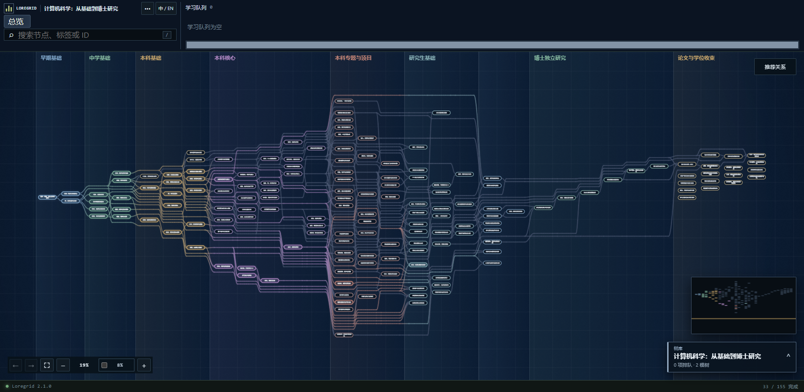
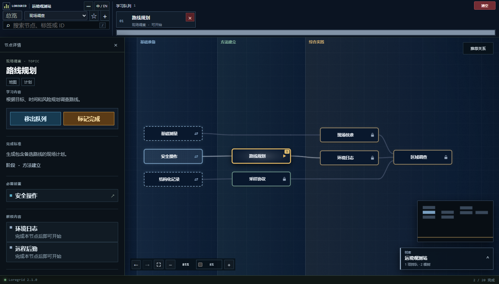

<p align="center">
  
</p>

<h1 align="center">Loregrid</h1>

<p align="center"><strong>把学习内容，变成看得见的成长路线。</strong></p>

<p align="center">
  用分页科技树梳理知识依赖，安排学习队列，记录进度与笔记。<br>
  离线使用 · 无需账号 · 自定义 JSON · MIT 开源
</p>

<p align="center">
  <a href="https://github.com/pheasant79/loregrid/releases/latest"></a>
  <a href="docs/README.zh-CN.md"></a>
  <a href="docs/create-with-codex.md"></a>
</p>

<p align="center">
  简体中文 · <a href="docs/README.en.md">English</a> · <a href="docs/README.md">文档导航</a> · <a href="https://github.com/pheasant79/loregrid/issues">反馈问题</a>
</p>



<p align="center"><sub>155 节点兼容示例的总览。截图来自当前源码构建，完成记录为演示数据；发行包功能以对应 Release 说明为准。</sub></p>

## 先看全貌，再决定下一步

面对一门新知识，难的往往不只是找到资料，还包括知道先学什么、缺少什么，以及已经走到了哪里。

Loregrid 将这些内容放进一张可以浏览的学习地图：按分页专注一个方向，用总览查看整体，沿依赖关系找到前置，把接下来要学的内容加入队列。

| 你想做的事 | Loregrid 提供什么 |
| --- | --- |
| 看清知识结构 | 独立分页、共享阶段和整棵树的总览 |
| 找到学习顺序 | 必需前置、跨页跳转，以及前置链排队 |
| 安排接下来的学习 | 可调整顺序的学习队列，手动记录完成状态 |
| 留下学习记录 | 每棵树独立的进度、笔记与备份 |
| 使用自己的内容 | 导入 AI 或作者编写的 JSON，自动计算节点位置与连线 |
| 管理不同主题 | 右下角树库切换，各棵树的队列和记录相互独立 |



*放大后查看节点内容与依赖，选中节点后安排学习、记录完成情况。图中的观测站内容和笔记均为演示。*

## 下载后，三步开始

**普通使用不需要安装 Node.js、pnpm 或 Vite。**

1. **下载并解压**：进入 [正式版本下载页](https://github.com/pheasant79/loregrid/releases/latest)，下载 `Loregrid-v…-offline.zip`，完整解压。
2. **打开应用**：双击解压目录里的 `index.html`，先用内置的虚构示例体验分页、搜索和学习队列。
3. **加载其他树**：从右下角树库导入 JSON；Chrome / Edge 也可在「⋯ → 选择数据文件夹」中连接 `data/`。

Firefox 支持离线浏览与手动导入；目前不支持本应用使用的文件夹连接方式。

需要逐步操作？阅读 **[图文使用指南](docs/README.zh-CN.md)**。已下载源码 ZIP 的用户，也可以直接打开根目录成品 `index.html`。

## 做一张自己的学习地图

告诉 AI 你的学习主题、现有基础和目标，让它按 Loregrid 格式生成树 JSON，再导入查看。
**节点位置和连线由应用计算，无需填写坐标。**

从 [创建学习树指南](docs/create-with-codex.md) 开始，也可以使用 [提示词](prompts/create-tree.zh-CN.md) 和 [最小模板](docs/templates/minimal-template-v2.json)。

```text
data/
├── trees/       树 JSON：学习内容，由 AI 或作者维护
└── progress/    进度 JSON：完成、队列、笔记等个人记录
```

树是固定的学习内容，进度是你在上面留下的记录。应用读取树文件，不修改其中的节点和分页。
连接并授权数据文件夹后，可重新读取 AI 改过的树，并在获得写入权限时保存独立进度文件。

**浏览器缓存不是备份。** 请保留原始树 JSON，定期备份重要进度。详见 [数据文件夹](docs/data-folder.md) 与 [隐私说明](docs/privacy.md)。

## 遇到问题，去这里找

- **[常见问题](docs/faq.md)**：为什么只有一棵示例树？为什么没有自动加载？进度保存在哪里？
- **[更新指南](docs/updates.md)**：v2.1.0 起提供应用内检查更新，说明如何更换程序并保留自己的数据。
- **[数据格式](docs/data-format.md)**：分页、节点、关系和全树共享阶段的定义。
- **[开发指南](docs/development.md)**：修改源码、构建、测试与生成发布包。

## 参与项目

欢迎通过 [Issues](https://github.com/pheasant79/loregrid/issues) 反馈问题、讨论交互或提出功能建议。
提交代码或通用学习树前，请阅读 [贡献指南](.github/CONTRIBUTING.md)。分享示例时请移除私人笔记和进度。

## 许可与致谢

Loregrid 采用 [MIT 许可证](LICENSE)。项目保留 Learning Tech Tree 的原有许可，并对借鉴和移植自 YART 的部分保留来源及 MIT 声明。

[第三方声明](docs/legal/THIRD_PARTY_NOTICES.md) · [YART 来源映射](docs/yart-source-map.md) · [功能对照与边界](docs/yart-parity.md)
