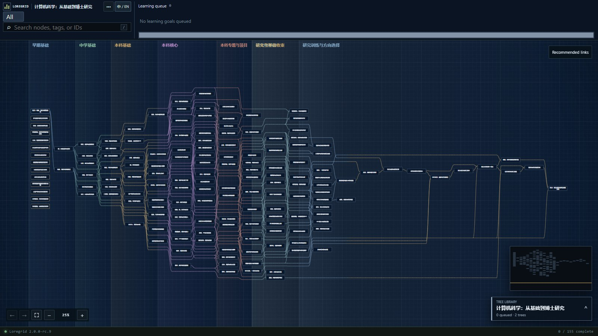

# Loregrid

**Paged, visual learning maps for exploring what to learn and how ideas connect.**

[简体中文](docs/README.zh-CN.md) · [Documentation index](docs/README.md) · [Data format](docs/data-format.md) · [Privacy](docs/privacy.md)

**Current source version:** `2.0.0-rc.9` (release candidate; no downloadable release yet).



*The full All view of the repository's 155-node computer science example. Fit-to-view shows the graph's scale and structure; zoom in to read individual nodes.*

Loregrid turns a subject into a navigable map instead of a long checklist. One tree contains focused pages and an **All** overview. Pages keep large subjects readable, while prerequisites can still connect ideas across pages. A tree may have several starting points and goals; it does not force one subject into a single linear course.

Use it to explore a learning map, search across its pages, inspect prerequisites and unlocks, plan a personal queue, and record progress. Loregrid is a general-purpose tool: it does not prescribe a subject, school, curriculum, research method, or study duration.

## Try Loregrid

There is currently **no hosted web demo or downloadable GitHub Release**. To try the application now, run it locally:

**Requirements:** Node.js 20 or newer and pnpm.

```powershell
git clone https://github.com/pheasant79/loregrid.git
cd loregrid
pnpm install
pnpm dev
```

Open the local URL printed by Vite. The app starts with a fictional sample tree; no account or network connection is needed for its core features.

To build a standalone HTML file that can be opened offline:

```powershell
pnpm build
```

Open `dist/index.html`. This file is generated locally and is intentionally not committed to the repository. To make a customer folder with a specific tree embedded, use `pnpm build:customer -- path/to/tree.json`; see the [customer delivery guide](docs/customer-delivery.md).

## What you can do

- **Organize a subject into pages.** Browse each page independently or open **All** to see the active tree as one overview.
- **Follow dependencies across pages.** Required prerequisites affect availability; recommended and related links provide context without blocking progress.
- **Explore and plan.** Search the whole tree, inspect node details, add learning goals to a queue, and mark or undo completion.
- **Keep trees separate.** Import multiple JSON trees into the in-app library. Each imported tree keeps its own queue, completion state, notes, and page selection.
- **Use existing data.** Open `learning-tech-tree/v1` files directly or create a `loregrid/tree-v2` tree from the starter template.

## Trees and saved data

Tree definitions are JSON files. Importing a file copies its contents into the current browser's local library; it does not watch or edit the original disk file. Queue, completion state, notes, and other personal progress are stored separately in that browser profile.

Loregrid has no account, backend, cloud sync, or telemetry. Browser-local data is not automatically shared between devices or browser profiles, and clearing browser data can remove it. Keep the original tree JSON and export a progress backup for each tree you want to preserve. Read [privacy and storage details](docs/privacy.md) before using private material.

For a new tree, start with [`data/templates/minimal-template-v2.json`](data/templates/minimal-template-v2.json) and the [tree format guide](docs/data-format.md). Validate a file with:

```powershell
pnpm validate -- path/to/tree.json
```

## Repository map

| Location | Purpose |
| --- | --- |
| `src/` | TypeScript application, graph model, layout, renderer, and Web Worker |
| `data/examples/` | Fictional example trees |
| `data/templates/` | Starter JSON for new trees |
| `data/compatibility/` | V1 data used to check migration support |
| `public/` and `schema/` | Public tree catalog, schemas, and web assets |
| `scripts/` | Validation, migration, benchmarking, and customer-package build |
| `tests/` | Unit tests, browser workflows, and screenshot baselines |
| `docs/` | User guides, data format, privacy, architecture, and project references |
| `dist/` | Generated output; ignored by Git and recreated by build commands |

For the full explanation, see [repository and delivery layout](docs/repository-layout.md).

## Development

```powershell
pnpm check
pnpm test
pnpm build
```

After the [local setup](#try-loregrid), run `pnpm test:e2e` for browser tests or `pnpm benchmark` for synthetic graph benchmarks. See [architecture](docs/architecture.md), [performance notes](docs/performance.md), and [contributing](CONTRIBUTING.md) for implementation details.

## License and attribution

Loregrid is distributed under the MIT License. The repository retains the original Learning Tech Tree license and separate YART attribution for reused material. See [`LICENSE`](LICENSE), [`THIRD_PARTY_NOTICES.md`](THIRD_PARTY_NOTICES.md), and the [YART source map](docs/yart-source-map.md).
