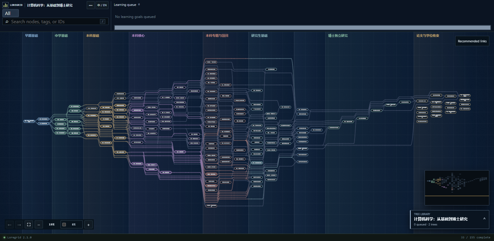
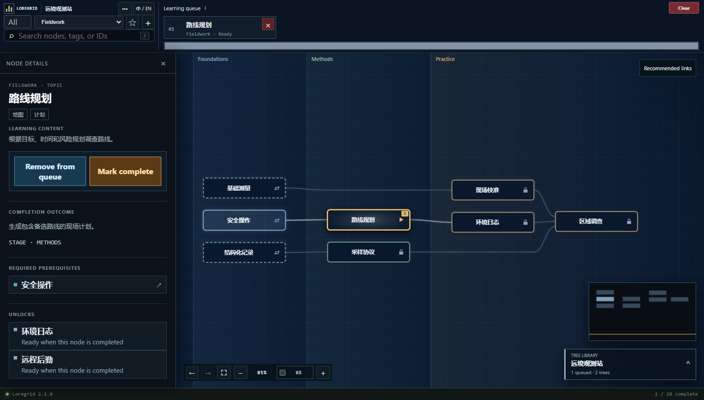

<p align="center"></p>

<h1 align="center">Loregrid</h1>

<p align="center"><strong>See the whole subject. Find your next step.</strong></p>

<p align="center">
  Explore knowledge as a paged learning tree. Follow prerequisites, build a queue,<br>
  and keep your progress and notes. Offline · No account · Custom JSON · MIT
</p>

<p align="center">
  <a href="https://github.com/pheasant79/loregrid/releases/latest"></a>
  <a href="user-guide.en.md"></a>
  <a href="create-with-codex.md#english"></a>
</p>

<p align="center">
  <a href="../README.md">简体中文</a> · English · <a href="README.md">Documentation</a> · <a href="https://github.com/pheasant79/loregrid/issues">Report an issue</a>
</p>



<p align="center"><sub>Public compatibility example with demonstration progress. Screenshots show the current source build; published packages follow their own Release notes. UI language does not translate authored tree content.</sub></p>

## A map for learning, one step at a time

A reading list does not always tell you what to learn first, what is missing, or how far you have come.
Loregrid puts that structure on a browsable map: focus on one page, step back to All, follow prerequisites, and queue your next goal.

| What you want to do | What Loregrid offers |
| --- | --- |
| Understand the structure | Focused pages, shared stages, and one whole-tree overview |
| Find a learning order | Required prerequisites, cross-page navigation, and prerequisite-chain queuing |
| Plan your next steps | Reorderable learning queues and manually recorded completion |
| Keep a learning record | Independent progress, notes, and backups for each tree |
| Bring your own subject | Import author- or AI-generated JSON; positions and connections are computed |
| Switch topics | A searchable tree library, with separate queues and records |



*Zoom in to inspect topics, review dependencies, and record learning. The station content and notes are fictional demonstrations.*

## Download and start

**Ordinary use needs no Node.js, pnpm, Vite, server, or account.**

1. **Download and extract** `Loregrid-v…-offline.zip` from the [stable Release page](https://github.com/pheasant79/loregrid/releases/latest).
2. **Open** the extracted `index.html` and try the bundled fictional tree.
3. **Add your trees** through the library at bottom right. Chrome / Edge can also connect `data/` through **⋯ → Choose data folder**.

Firefox supports the offline app and manual JSON import; the app's folder-connection API is not supported there.

Follow the [illustrated user guide](user-guide.en.md) for detailed steps. If you downloaded the source ZIP, the top-level `index.html` is also a ready app.

## Bring your own learning map

Ask an AI or author to describe a subject, its pages, topics, and prerequisites in Loregrid JSON.
**No coordinates are required: the app lays out nodes and connections.**

Start with the [authoring guide](create-with-codex.md#english), [copyable prompt](../prompts/create-tree.md), or [minimal template](templates/minimal-template-v2.json).

```text
data/
├── trees/       Content JSON, maintained by an author or AI
└── progress/    Personal completion, queue, notes, and view settings
```

Loregrid reads tree definitions without editing their nodes or pages. With folder access granted, it can reload authored changes and save separate progress files when write permission is available.

**Browser storage is not a backup.** Keep original tree files and back up important progress. Read about [data folders](data-folder.md) and [privacy](privacy.md).

## Find help

- [User guide](user-guide.en.md): importing, navigation, learning, and backups.
- [FAQ](faq.md#english): entry files, the bundled example, folder access, and progress.
- [Updating Loregrid](updates.md#english): replace the app while keeping your data. The in-app checker is available from v2.1.0.
- [Data format](data-format.md): pages, nodes, relationships, and shared stages.
- [Development](development.md#english): source setup, builds, tests, and packaging.

## Contribute

Use [Issues](https://github.com/pheasant79/loregrid/issues) to report problems or discuss improvements.
Read the [contribution guide](../.github/CONTRIBUTING.md) before submitting code or general-purpose trees. Remove personal progress and private notes from examples.

## License and acknowledgements

Loregrid uses the [MIT License](../LICENSE), preserving the original Learning Tech Tree license and the applicable MIT notices for adapted YART work.

[Third-party notices](legal/THIRD_PARTY_NOTICES.md) · [YART source map](yart-source-map.md) · [Behavior and limitations](yart-parity.md)
