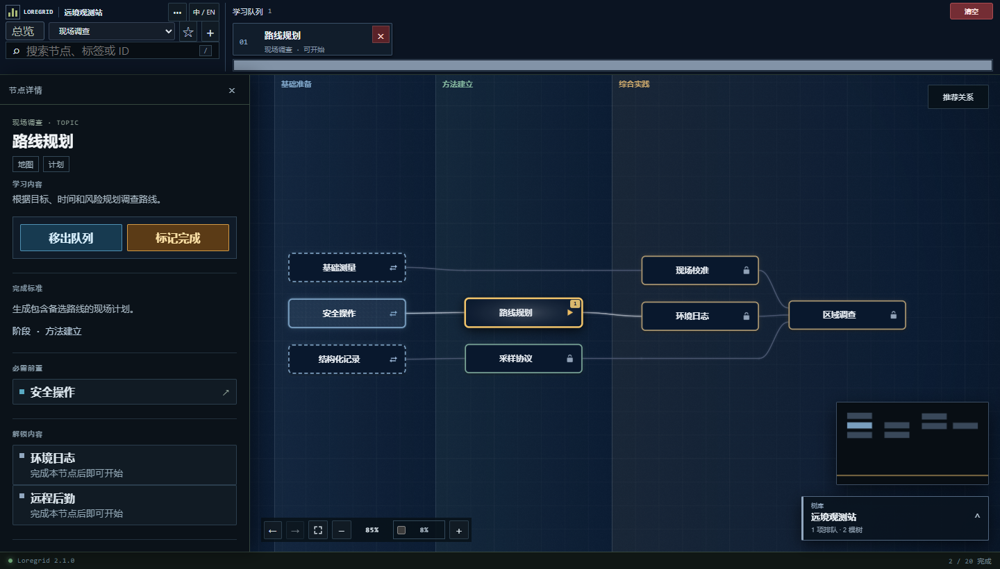

# Loregrid 使用指南

[项目首页](../README.md) · [English](user-guide.en.md) · [常见问题](faq.md)

先打开应用，再加载学习内容。普通使用不需要安装开发工具，也不需要账号。

## 1. 下载并打开

在 [正式版本下载页](https://github.com/pheasant79/loregrid/releases/latest) 下载 **`Loregrid-v…-offline.zip`**，完整解压后双击 **`index.html`**。

如果下载的是源码 ZIP，也可以打开根目录的成品 `index.html`。不要打开 `src/index.html`：那是开发模板。GitHub 的文件预览页也不是在线应用。

首次打开会显示「远境观测站」虚构示例。先试试缩放、选择节点和切换分页，再换成自己的内容。

## 2. 认识界面



*截图来自当前源码构建，观测站内容、完成记录和笔记均为演示。*

- **左上角**：选择分页，或勾选「总览」查看当前树的全部节点。
- **顶部队列**：查看接下来的学习内容，调整顺序，移除或清空排队项。
- **中央画布**：拖动平移、滚轮缩放；使用适配视图重新找到全图。
- **节点详情**：选择节点后，在左侧查看介绍、学习成果、操作和关系。
- **右下角树库**：切换已加载的树，或手动导入树 JSON。

搜索会查找当前树的节点。选择结果可切到对应分页并定位。界面可切换中英文；树作者写的内容不会自动翻译。

## 3. 加载自己的树

### 手动导入：所有受支持浏览器都可用

在右下角树库选择导入 JSON，选中 AI 或作者生成的树文件。

应用会保存一份浏览器缓存。之后 AI 修改原 JSON 时，再次导入同一棵树即可读取新版；请保留树 ID 和已有节点 ID，以便对应原有进度。

### 连接文件夹：Chrome / Edge

如果希望启动时读取文件夹中的树：

1. 将树 JSON 放入 **`data/trees/`**。
2. 打开应用的 **「⋯ → 选择数据文件夹」**。
3. 选择 **`data/`** 并授权，**不要选里面的 `trees/`**。
4. 授权仍有效时，应用会在启动时读取树；失效时使用「重新授权数据文件夹」。

AI 在应用打开期间修改了 JSON，可选择 **「重新读取数据文件夹」**；不需要重新构建程序。

Firefox 请使用手动导入。仅双击 HTML 不会自动获得旁边文件夹的访问权限。详见 [数据文件夹说明](data-folder.md)。

## 4. 安排学习和记录完成

选择一个节点，先查看介绍与成果，再使用详情中的主要操作：

| 操作 | 作用 |
| --- | --- |
| 加入队列 | 安排接下来的学习；按界面选项加入当前节点或缺失前置 |
| 移出队列 | 取消排队，不删除学习内容 |
| 标记完成 | 手动记录已学会当前节点 |
| 撤销完成 | 单独取消完成，不会级联取消后续节点 |

多个必需前置采用 **AND**：全部满足才算具备条件。「推荐」和「相关」关系不锁定节点。

「解锁内容」展示后续关联的开放条件；完成当前节点不代表其他前置也自动满足。若取消了某个前置，后续已完成节点会提示状态不一致。

没有按天自动研究或自动完成。队列用来安排顺序，完成状态由你记录。

## 5. 留笔记、做备份

在详情中填写私人笔记。每棵树的完成状态、队列、笔记和视图记录相互独立。

```text
data/
├── trees/       学习内容：由 AI 或作者维护
└── progress/    学习记录：由应用保存或备份
```

**树文件是学习内容，进度文件是个人记录。** 应用不会修改树 JSON 里的节点和分页。

平时应用保存浏览器本地记录；连接并授予写入权限后，也可保存独立进度文件。未连接文件夹时，使用菜单中的进度备份下载 JSON，下载位置由浏览器设置或保存对话框决定；你可以将它放入 `data/progress/`。

恢复时先打开对应树，再导入它的进度备份。重要树请分别备份。**浏览器缓存不是备份**，清理浏览器、换配置或换电脑前尤其要注意。

[隐私与本地存储](privacy.md) 解释了保存范围；[常见问题](faq.md) 说明换浏览器和恢复记录时的注意事项。

## 6. 分清两种更新

**更新学习内容**：AI 改树 JSON → 重新读取已授权数据文件夹，或再次手动导入。

**更新程序**：备份重要进度 → 下载新版程序 → 保留 `data/` 并替换应用 HTML。完整步骤见 [更新指南](updates.md)。

> **v2.1.0 起**可点击左下角版本号或使用「检查更新」。旧的 v2.0.0 发行包没有这个入口；看不到按钮时，直接到 Releases 下载即可。

## 接下来

- 想用自己的主题：[让 AI 创建学习树](create-with-codex.md)。
- 不清楚文件和数据：[常见问题](faq.md)。
- 想修改程序源码：[开发指南](development.md)。
