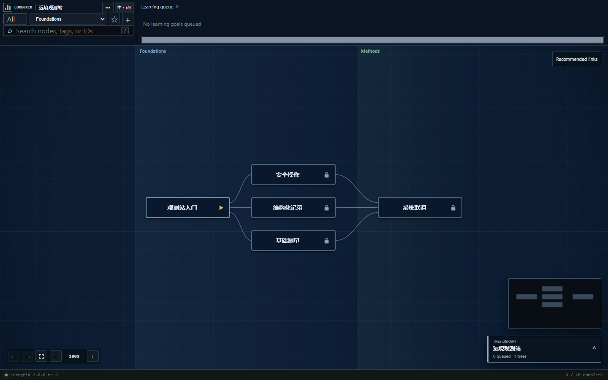

# Loregrid 中文说明

> 当前没有托管的在线演示或 GitHub Release。可以按下方步骤在本机运行；构建产物不会自动上传到 GitHub。



*截图展示内置的虚构示例树；示例节点为中文，界面可切换中英文。*

Loregrid 是一个用于浏览和制作**分页式学习树**的开源应用。学习树把知识主题、学习目标以及它们之间的依赖关系画在一起，帮助使用者看清「可以学什么、需要先学什么、各个主题如何组成更大的知识图谱」。它适用于自主学习计划、课程知识图谱，以及其他需要呈现关系和先后条件的知识地图；应用不限定学科、学校、课程时长或研究方法。

一棵 Loregrid 树代表一个主题地图，由多个分页组成。每个分页聚焦其中一部分内容；「总览」把这棵树的所有分页放在同一张图里。节点的必需前置可以来自其他分页，因此分页负责整理视图，不会切断主题之间的依赖。树可以有多个起点和终点，不要求所有内容都从一个根节点沿着唯一顺序学习。

使用者可以在分页间切换、查看节点关系、搜索整棵树、安排个人学习队列，并记录完成状态和私人笔记。每棵树的队列、完成记录和笔记分开保存于当前浏览器的本地配置中；它们不会随树 JSON 一起公开，也不会自动同步到服务器。应用可以作为静态网页运行，也可以构建成可离线双击打开的单文件 HTML；没有账号系统、后台或云同步。

这个仓库不只有一个网页入口，还包含可阅读的应用源码、图布局和数据处理算法、树数据格式、示例数据、模板与 V1 兼容数据。内置演示树是虚构示例，并非规定的学习课程；你可以先体验它，再导入自己的 V1/V2 JSON，或从模板开始制作。源码位于 `src/`，数据分类位于 `data/`，客户交付包由构建命令生成到 `dist/`。目录用途见[仓库目录说明](repository-layout.md)。

先看：[文档导航](README.md) · [仓库与交付目录说明](repository-layout.md) · [客户交付说明](customer-delivery.md)

## 本地运行

需要 Node.js 20 或更新版本。

```powershell
pnpm install
pnpm dev
```

生成可双击打开的单文件离线页面：

```powershell
pnpm build
```

结果位于 `dist/index.html`。使用者不需要安装 npm、登录账号或连接服务器。

如果是给客户的版本，使用 `pnpm build:customer -- path/to/customer-tree.json`，然后把
`dist/customer-delivery/` 整个文件夹交给客户。客户只需双击其中的 `Loregrid.html`；
不需要打开源码仓库或运行开发命令。

## 添加和切换树

点击右下角的「树库」，再点「添加树」，可一次选择多个 V1/V2 JSON 文件。也可以使用左上角菜单中的打开入口。树库显示树名和文件名，点击即可打开；每棵树分别保留队列、完成记录、笔记、组合分页和上次打开的分页。即使两份文件的树 ID 相同，本地进度也互不混用。

树多时，展开列表有搜索框和内部滚动条，高度受限；收起后只显示当前树和数量，不会一直向上铺满画面。总览和组合页仅属于当前打开的树，不合并其他树。

添加的内容会复制到当前浏览器的本地存储，刷新后可以继续打开；不会上传或修改原 JSON。浏览器不能自动扫描磁盘文件夹，原文件修改后需要重新导入。清理浏览器数据、换浏览器或移动离线 HTML 文件可能让原树库不可用，请保留原 JSON，并为各树分别导出进度备份。若存储不可用，界面会提示本次导入仅在当前会话有效。

## 创建自己的树

复制 `data/templates/minimal-template-v2.json`，保持节点 ID 稳定，并阅读 `docs/data-format.md`。私人学习树不要提交到公开仓库；`local-data/` 只是开发者临时输入目录，运行时树库保存在浏览器本地。

校验或迁移：

```powershell
pnpm validate -- data/examples/loregrid-demo.json
pnpm migrate -- data/compatibility/learning-tech-tree-v1-template.json data/new-v2-tree.json
```

旧版 `learning-tech-tree/v1` 可以直接在界面中打开，Loregrid 会在内存中转换，不会修改原文件。

## 关系含义

- `required`：硬前置，会影响解锁和主要排版；多个前置表示 AND。
- `recommended`：有方向的推荐，不锁定节点。
- `related`：无方向的相关内容，通常只在详情中显示。

本项目不包含 RimWorld 本体美术资源、游戏代码和模组运行逻辑；复用的 YART 自有 MIT 纹理保留了声明与来源。算法借鉴与 MIT 归属见 `THIRD_PARTY_NOTICES.md`。
