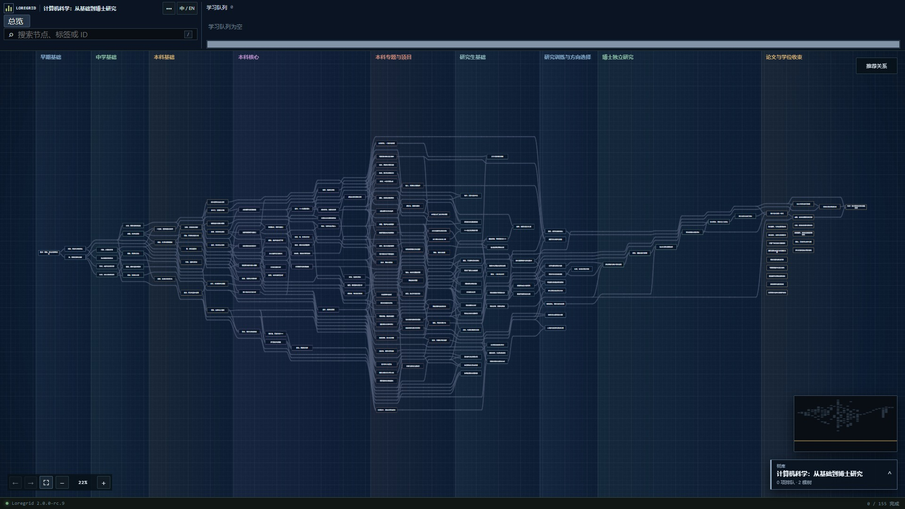

# Loregrid 使用指南

Loregrid 用分页式关系图呈现学习主题。每棵树包含多个分页和一个「总览」，可查看局部内容，也可回看整体依赖。



*这是 155 节点示例树的总览；每一列代表一个学习阶段，放大后可查看主题和前置关系。*

## 普通用户启动

推荐到 [Releases](https://github.com/pheasant79/loregrid/releases) 下载
**`Loregrid-v…-offline.zip`** 附件，完整解压后双击 `index.html`。
包内的 `使用说明-START-HERE.txt` 说明了数据文件夹授权与进度备份。

也可以在 GitHub 点击 **Code → Download ZIP**，解压后打开根目录的 `index.html`，或克隆仓库。
这是已经构建好的离线应用，不需要安装 Node.js、pnpm 或 Vite。直接双击 HTML 可使用内置的
虚构示例树，但浏览器不会扫描旁边的 `data/` 文件夹。

要添加其他树，可以在树库菜单手动导入 JSON。若要让应用读取并刷新 `data/trees/` 文件夹，
请在 Chrome 等支持文件夹访问的浏览器中，选择 `data/` 文件夹并授权；不需要为此重新构建应用。
Firefox 等不支持该文件夹访问功能的浏览器，请使用手动导入。

## 开发者启动

只有修改 TypeScript 源码的开发者才需要 Node.js 20+ 和 pnpm，在仓库目录运行：

```powershell
pnpm install
pnpm dev
```

打开终端显示的本地地址。应用会载入虚构示例树，核心功能不需要账号或联网。

## 导入和浏览

1. 打开左上角「⋯」菜单，点击「选择数据文件夹」，选择 `data/` 文件夹并授权（不要选择里面的 `trees/`）。授权仍有效时，应用会在启动时读取 `trees/`；权限失效后，选择「重新授权数据文件夹」。右下角「树库」用于切换树和手动导入 JSON。
2. AI 新建或更新树 JSON 后，放进 `data/trees/`；应用已打开时选择「重新读取数据文件夹」。Firefox 等浏览器可手动导入 JSON，更新后需再次导入。
3. 使用左上角的分页选择器浏览；选择「总览」查看当前树。
4. 选择节点查看说明和前置条件，再加入队列或记录完成状态。

不同树的分页、队列、完成状态和笔记彼此独立。`required` 是必需前置；多个前置都要满足。`recommended` 和 `related` 只供参考。

## 保存与备份

- 树 JSON 保存固定学习内容，应用只读取，不修改原文件。
- 队列、完成状态和私人笔记保存在独立进度 JSON；连接数据文件夹时写入 `data/progress/`，并保留浏览器本地缓存。
- 应用没有账号、后台或云同步；换浏览器或清除浏览器数据后，记录可能无法恢复。

请保留原始 JSON，并为重要学习记录导出进度备份。更多信息见[隐私与本地存储](privacy.md)。

## 重新生成成品

```powershell
pnpm build
```

构建会更新根目录 `index.html`（用户直接打开的成品）。`src/index.html` 是开发模板，`dist/` 是忽略的构建中间产物，普通使用无需进入这两个目录。根目录成品默认内置一棵示例树；其他树需手动导入，或在支持的浏览器中连接数据文件夹。
普通用户不需要执行这个命令。

## 创建树文件

复制 [`templates/minimal-template-v2.json`](templates/minimal-template-v2.json)，按[树数据格式](data-format.md)填写，再把生成的 JSON 放入 `data/trees/`，然后运行：

```powershell
pnpm validate -- path/to/tree.json
```

## 文档

[文档索引](README.md) · [仓库结构](repository-layout.md) · [数据格式](data-format.md) · [隐私与存储](privacy.md)
