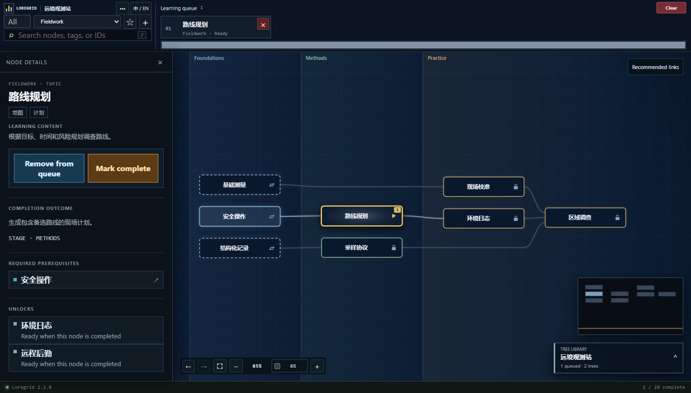

# Loregrid user guide

[Project home](README.en.md) · [简体中文](README.zh-CN.md) · [FAQ](faq.md#english)

Use the ready app first. Development tools and an account are not required.

## Download and open

Download **`Loregrid-v…-offline.zip`** from [Releases](https://github.com/pheasant79/loregrid/releases/latest), extract the complete package, and open **`index.html`**.

The source ZIP also includes a ready app at the root. `src/index.html` is a development template, and GitHub's HTML file preview does not launch the app.

Your first launch shows a fictional station example.

## Find your way around

*Current source build; content, progress, and notes are demonstration data. UI language does not translate authored content.*

- **Top left:** select a page, or use All for the current whole tree.
- **Top queue:** arrange upcoming learning, reorder items, or remove them.
- **Canvas:** drag to pan, scroll to zoom, and fit the view to find the graph again.
- **Details:** select a node to read its description, outcomes, actions, and relationships on the left.
- **Bottom-right library:** switch trees or import JSON.

Search finds nodes in the current tree and navigates to their page.

## Load a tree

**Manual import:** use the tree library to select a tree JSON. If its author later changes the file, import it again. Keep the same tree and node IDs to associate existing progress.

**Connected folder, Chrome / Edge:**

1. Place authored JSON in `data/trees/`.
2. Choose **⋯ → Choose data folder** and select **`data/`**, not `trees/`.
3. Grant access. While permission remains valid, the app reads trees at startup.
4. Use **Reload data folder** after an author changes files while the app is open. Reconnect if permission expires.

Firefox uses manual import. Opening HTML does not grant access to neighbouring files. See [folder access](data-folder.md).

## Queue, complete, and take notes

Select a node, read its scope and outcome, then use **Add to queue** or **Mark complete**. Queue options let you include missing prerequisites. **Remove from queue** cancels planning; **Undo complete** changes the record without deleting content.

All required prerequisites must be satisfied (AND). Recommended and related connections do not gate learning. Unlock details may still list other prerequisites. Undoing a prerequisite does not cascade through completed nodes; inconsistent records are flagged.

Learning does not finish automatically after a timer. Completion is recorded manually.

Write private notes in the details panel. Each tree has its own queue, completion, notes, and view records.

## Back up and restore

Tree definitions belong in `data/trees/`; separate progress files belong in `data/progress/`. The app reads authored trees without changing their nodes or pages.

Records are saved in browser storage. A connected folder with write permission also allows separate progress files. Without folder access, the backup action downloads JSON; the browser decides its download location. You can keep it in `data/progress/`.

Open the matching tree before restoring its progress. Back up each important tree separately. **Browser storage is not a backup:** clearing it or changing browser/profile/location can lose access to records. Read [privacy and storage](privacy.md).

## Update content or update the app?

**Content:** reload the connected folder or reimport the edited JSON.

**App:** back up progress, download the new program, preserve `data/`, and replace the app HTML. See [update instructions](updates.md#english).

The in-app update checker is available **from v2.1.0**. The older v2.0.0 package has no checker; visit Releases manually if the button is absent.

## Continue

[Create a tree](create-with-codex.md#english) · [FAQ](faq.md#english) · [Development](development.md#english)
